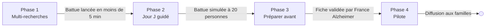

# Roadmap — Battue : appli de coordination des bénévoles

25 octobre 2026 · Damien Cirotteau

## Cap et principes

L'objectif : qu'une famille lance une battue coordonnée en moins de 5 minutes, et qu'un bénévole soit opérationnel en moins d'une minute après avoir ouvert le lien WhatsApp. L'outil synchronise les bénévoles sur le terrain ; il ne suit pas la personne disparue et ne remplace pas la police.

- **Zéro installation, zéro compte.** Une page web, un lien, un code. Pas d'app à télécharger, pas d'inscription.
- **Un seul écran par rôle.** Le coordinateur crée et pilote ; le bénévole voit son secteur, sa position, et signale.
- **Le savoir de terrain est dans l'interface.** Secteurs proches en priorité, consignes « regarder, ne pas appeler », lieux du passé : l'outil guide sans formation.
- **Éphémère par défaut.** Une recherche se clôture et ses données sont supprimées.
- **Chaque fonctionnalité doit répondre à « est-ce que ça fait gagner du temps le jour J ? ».** Sinon, elle attend.

## Point de départ

La carte utilisée le 25 octobre fonctionne mais est codée pour une seule recherche : adresse, grille et code équipe sont écrits en dur.

| Brique | Aujourd'hui | Limite pour un usage général |
| --- | --- | --- |
| Page carte | GitHub Pages, Leaflet + OpenStreetMap | Adresse et grille fixes dans le code |
| Grille | 7 × 6 carrés de 500 m, positionnés à la main | Pas centrée automatiquement sur le point de départ |
| Partage en direct | Worker Cloudflare + KV, rafraîchi toutes les 10 s | Un seul jeu de données, un seul code |
| Accès | Code équipe partagé sur WhatsApp | Pas de distinction coordinateur / bénévole |
| Fonctions | Statut des secteurs, position GPS, signalements, lien par secteur | Pas d'avis de recherche, pas de clôture ni de suppression |

## Architecture cible

On garde la pile actuelle, qui a fait ses preuves, et on ajoute une **Durable Object Cloudflare par recherche** : chaque battue a son propre espace de données isolé, cohérent, et diffusé en direct aux bénévoles.

- **Front** : un seul Worker Cloudflare sert le site, l'application et l'API sur battue.org (voir « Site et hébergement »). L'adresse `/r/<id-recherche>` ouvre la bonne battue.
- **API** : le worker actuel devient un routeur ; chaque recherche est servie par sa Durable Object.
- **Temps réel** : WebSocket depuis la Durable Object, avec repli sur un rafraîchissement toutes les 10 s si la connexion tombe.
- **Accès sans compte** : deux liens générés à la création. Le lien coordinateur donne tous les droits ; le lien bénévole permet de mettre à jour son secteur et de signaler. Le jeton est dans la partie `#` du lien, donc absent des journaux serveur.
- **Suppression automatique** : à la clôture, ou au bout de 30 jours sans activité, la Durable Object efface ses données.
- **Hébergement** : vérifier qu'on peut contraindre les données à l'UE (option de juridiction des Durable Objects).

| Objet | Contenu | Durée de vie |
| --- | --- | --- |
| Recherche | Point de départ, heure, photo, description, numéro à appeler, lien WhatsApp | Jusqu'à la clôture |
| Secteur | Statut, équipe, note, heure de mise à jour | Idem |
| Signalement | Position, texte, prénom, heure | Idem |
| Bénévole | Prénom, position récente (si partagée), heure de départ et de retour | Position effacée au bout de 15 min |
| Journal | Toutes les actions horodatées, exportable pour la police | Idem |

## Site et hébergement

Tout tient sur Cloudflare, sur un seul domaine, pour environ 5 $ par mois plus le nom de domaine. Le gratuit suffirait en volume, mais il coupe le service net quand une limite journalière est atteinte : inacceptable un jour de battue.

**Adresses**

- `www.battue.org` : page de présentation, avec un bouton « Lancer une battue » en haut de page.
- `battue.org/r/<code>` : une battue. Adresse courte, facile à lire sur une affiche et dans un QR code. Même origine que le site : pas de configuration croisée, un seul déploiement.
- `app.battue.org` : redirige simplement vers `www.battue.org`, au cas où on le tape.

**Page de présentation** (livrée en phase 1)

- En tête : « Un proche a disparu ? Prévenez le 17, puis organisez la battue en 5 minutes. » et le bouton de lancement.
- Comment ça marche en 3 étapes : créer, partager sur WhatsApp, chercher ensemble.
- Les avantages : gratuit, sans compte ni installation, données supprimées à la fin.
- Les bons réflexes pour une personne désorientée : chercher près, regarder sans appeler, buissons, fossés et berges.
- Préparer à l'avance : la fiche famille (phase 3).
- Qui est derrière, contact, confidentialité, code ouvert.

| Brique | Choix | Coût | Pourquoi |
| --- | --- | --- | --- |
| Site, appli, API | Un Worker avec ses fichiers statiques | Inclus dans Workers Paid, 5 $/mois | Un seul déploiement, même origine, rapide partout |
| Données de chaque battue | Une Durable Object SQLite par battue | Largement dans les quotas inclus | Isolée, cohérente, suppression simple |
| Temps réel | WebSocket avec hibernation | Quasi nul | Pas de facturation pendant l'attente, contrairement au rafraîchissement toutes les 10 s qui consommerait vite les quotas |
| Fond de carte | OpenFreeMap (vecteur, MapLibre), tuiles OpenStreetMap en secours | Gratuit | Pas de clé, usage commercial permis ; serveur OSM réservé à un usage modéré |
| Adresses | Base Adresse Nationale | Gratuit | Service public, appelé depuis le navigateur |
| Avis de recherche PDF | Généré dans le navigateur | Gratuit | Aucune charge serveur |
| Compteurs admin | Workers Analytics Engine | Inclus | Pas de base à gérer |
| Test toutes les heures | Tâche planifiée Cloudflare | Inclus | Voir « Suivi d'exploitation » |
| Alertes | ntfy (notification sur téléphone) | Gratuit | Simple, sans compte |
| Nom de domaine | battue.org, DNS chez Cloudflare | Environ 10 à 15 €/an | Déjà acheté |

GitHub Pages n'est plus nécessaire : garder le front et l'API au même endroit évite une panne de plus et une configuration de plus. Les deux services de cartes gratuits n'offrent aucune garantie de disponibilité ; l'adresse des tuiles reste donc configurable pour basculer vers un fournisseur payant si besoin.

## Phases

Quatre phases, chacune utilisable seule et fermée par un test concret. Pas de dates : à fixer selon ton temps disponible.

La phase 1 suffit déjà à rendre service : tout le reste améliore une battue qui fonctionne.

### Phase 1 — Le socle multi-recherches

N'importe qui peut lancer sa propre battue.

- Écran de création unique : adresse (Base Adresse Nationale), heure de disparition, photo, description et tenue, numéro unique à appeler, lien du groupe WhatsApp.
- Grille générée automatiquement autour du point de départ, avec des anneaux à 500 m, 1 km, 1,6 km et 3 km ; les secteurs du premier anneau sont marqués prioritaires.
- Deux liens générés : coordinateur et bénévole.
- Bouton « Partager sur WhatsApp » qui prépare le message d'invitation (lien bénévole, photo, consignes de base) à coller dans le groupe.
- Clôture de la recherche en un bouton, avec suppression des données.

**Critère de sortie :** une personne qui n'a jamais vu l'outil crée une battue et invite 5 bénévoles en moins de 5 minutes, sans aide.

### Phase 2 — Le jour J bien guidé

Le coordinateur pilote, les bénévoles savent quoi faire.

- Accueil bénévole de 30 secondes : prénom, binôme, et les consignes clés (regarder sans appeler, fouiller buissons, fossés et berges, ne pas entrer chez les gens, pas de berges seul ni la nuit).
- Attribution d'un secteur à un binôme en un geste ; le binôme reçoit son lien de secteur.
- Pointage de départ et de retour ; alerte au coordinateur si un binôme dépasse son temps prévu.
- Avis de recherche généré automatiquement (image et PDF) avec QR code vers la carte, prêt à imprimer ou partager.
- Bandeau du temps écoulé, heure de la tombée de la nuit et température annoncée.
- Journal horodaté exportable pour la police.

**Critère de sortie :** battue simulée avec une vingtaine de personnes, sans explication orale préalable.

### Phase 3 — Préparer avant la disparition

Gagner les premières minutes, les plus précieuses.

- Fiche de préparation, sur le modèle du Herbert Protocol britannique : photo récente, habitudes, traitements à signaler, anciens lieux de vie, endroits où la personne a déjà été retrouvée, lien du groupe WhatsApp familial.
- **Pas de compte : un lien secret chiffré.** La fiche est chiffrée dans le navigateur ; le serveur ne stocke que du contenu illisible ; la clé est dans la partie `#` du lien, que la famille garde et partage entre proches.
- Les proches qui ont le lien consultent et mettent à jour la fiche. Lien perdu = fiche perdue : l'outil invite à l'imprimer en QR code et à le ranger avec les papiers importants.
- Bouton « Lancer une battue » depuis la fiche : la recherche est créée pré-remplie, en un clic.
- Les lieux du passé apparaissent sur la carte comme points à visiter en priorité.
- Relance d'une recherche clôturée avec la même fiche et le même groupe, puisque près d'un tiers des personnes disparaissent plusieurs fois.

**Critère de sortie :** le contenu de la fiche est validé par France Alzheimer.

### Phase 4 — Pilote avec France Alzheimer

Passer d'un outil de famille à un service.

- Garde-fous contre le détournement et conformité RGPD (section suivante).
- Comptes uniquement si France Alzheimer veut que ses antennes suivent les familles qu'elles accompagnent : connexion par lien e-mail, sans mot de passe. C'est alors un besoin de l'association, à cadrer avec elle (responsabilité des données, hébergement).
- Nom de domaine neutre, page d'accueil expliquant quand l'utiliser et comment prévenir les secours.
- Code ouvert, documentation, procédure de signalement d'abus.
- Pilote sur quelques antennes locales, avec un retour d'expérience après chaque battue réelle.

**Critère de sortie :** décision de France Alzheimer de diffuser l'outil auprès des familles.

### Ensuite, seulement si le terrain le demande

- Traces de passage des bénévoles et carte de couverture.
- Mode hors connexion (zones sans réseau).
- Accès lecture seule pour la police ou la gendarmerie.

## Suivi d'exploitation (admin)

L'administrateur voit si le service fonctionne et s'il est utilisé, sans jamais accéder au contenu d'une recherche. C'est indispensable puisque l'outil servira rarement, chez des gens que tu ne connais pas.

**Le cloisonnement est technique, pas seulement une règle.** Chaque recherche n'est lisible qu'avec ses liens à jeton ; les fiches sont chiffrées ; la console admin ne reçoit que des compteurs envoyés par le worker. L'admin peut fermer une recherche par son identifiant sans en voir le contenu.

| Ce que l'admin voit | Ce qu'il ne voit jamais |
| --- | --- |
| Recherches actives, créées, clôturées, durée | Adresse, nom, photo, description |
| Nombre de bénévoles connectés, de secteurs mis à jour, de signalements | Prénoms, positions, textes des signalements |
| Étapes franchies : création → partage → premier bénévole → premier secteur | Contenu des fiches de préparation |
| Erreurs serveur et navigateur (sans données saisies), temps de réponse, connexions temps réel | Liens et jetons d'accès |

**Savoir que ça marche, même sans utilisateurs.** Un test automatique toutes les heures crée une fausse recherche, connecte un faux bénévole, met à jour un secteur, signale, clôture et vérifie la suppression. En cas d'échec, une alerte part sur ton téléphone. C'est le seul moyen d'être sûr que l'outil répondra le jour où une famille en aura besoin.

**Alertes**

- Le test automatique échoue.
- Taux d'erreur anormal ou service injoignable.
- Une recherche active sans aucun bénévole après 30 minutes : signe que l'invitation ne fonctionne pas.

**Outillage** : Workers Analytics Engine pour les compteurs, une tâche planifiée Cloudflare pour le test, et un tableau de bord dans ton Grafana si tu veux tout regrouper. Le test automatique et les compteurs de base arrivent dès la phase 1.

## Hors périmètre volontaire

Ces idées sont tentantes mais ralentiraient le lancement ou brouilleraient la simplicité.

- **Suivi GPS de la personne disparue** (bracelets, balises) : d'autres produits le font, et la police constate qu'ils sont souvent absents le jour J.
- **Application mobile à installer** : un lien web suffit et ne coûte aucune minute.
- **Comptes utilisateurs** : les liens à jeton suffisent pendant une battue.
- **Création automatique du groupe WhatsApp ou publication dans le groupe** : WhatsApp ne le permet pas sans API professionnelle ; un message prêt à coller suffit.
- **Diffusion sur les réseaux sociaux** : l'avis de recherche est partageable, mais la diffusion reste une décision de la famille et de la police.
- **Recherches de longue durée ou enquêtes** : l'outil sert la battue locale des premières heures et des premiers jours.

## Garde-fous et questions ouvertes

Le principal risque n'est pas technique : c'est qu'un outil qui mobilise des inconnus pour retrouver quelqu'un serve à traquer une personne partie volontairement.

**Garde-fous prévus**

- Message clair à la création : prévenir d'abord le 17 ou le 112, l'outil vient en complément.
- Engagement du coordinateur à avoir signalé la disparition aux forces de l'ordre (case à cocher, voire référence de la déclaration).
- Données minimales, pas de diagnostic médical stocké, suppression à la clôture ou après 30 jours sans activité.
- Fiches de préparation chiffrées de bout en bout : le serveur ne peut pas les lire, ce qui évite de détenir des données de santé lisibles.
- Positions des bénévoles conservées 15 minutes au plus.
- Bouton de signalement d'abus et possibilité de fermer une recherche à distance.

**Questions à poser à France Alzheimer**

- [ ] Combien de disparitions par an chez les familles qu'elle accompagne, et comment se passent-elles ?
- [ ] Qui doit pouvoir lancer une battue : toute famille, ou via une antenne locale ?
- [ ] Quel contenu pour la fiche de préparation, et qui la conserve ?
- [ ] Faut-il une vérification de la déclaration de disparition avant d'ouvrir une recherche ?
- [ ] Qui porte la responsabilité du traitement des données au sens du RGPD ?
- [ ] Comment se coordonner avec la police et la gendarmerie, et existe-t-il des contacts nationaux ?
